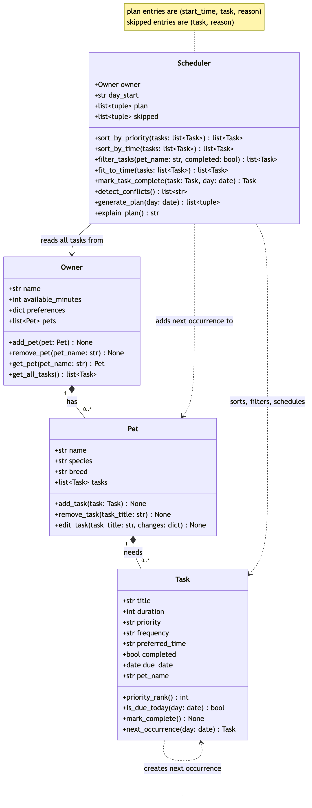

# 🐾 PawPal+

PawPal+ is a Streamlit app that helps a busy pet owner plan a day of pet care. You add your pets and their care tasks (walks, feeding, medication, grooming, play), and PawPal+ builds a schedule that fits the time you have, puts the most important care first, keeps recurring tasks coming back, and warns you when two tasks clash.

## ✨ Features

- **Multiple pets, one plan.** The scheduler reads every pet's tasks through the owner, so one schedule covers all of your pets.
- **Priority-first planning.** High-priority tasks get time first, then medium, then low. Ties go to the shorter task.
- **Time budget.** Tasks that don't fit in the minutes you have today are left out, and the app tells you which ones and why.
- **Preferred times.** A task with a preferred time (like a pill at 08:00) is placed at that time. Other tasks fill the open gaps from the start of your day without overlapping.
- **Sorting by time.** Task lists are shown in clock order. Times without a leading zero (`9:15`) sort correctly, and untimed tasks go last.
- **Filtering.** Show tasks for one pet or all pets, and to-do, done, or all.
- **Daily and weekly recurrence.** Completing a daily task automatically creates tomorrow's copy, and a weekly task comes back in 7 days. One-time tasks don't repeat. Completing the same task twice doesn't create duplicates.
- **Conflict warnings.** If two planned tasks overlap, for the same pet or different pets, you get a warning naming both tasks. Nothing crashes, and the decision stays with you.
- **Plain-English explanation.** Every plan comes with a summary of the time used, how tasks were chosen, what was left out, and any conflicts.
- **Input checks.** Blank names, duplicate pet names, and times like `25:99` are rejected with a clear message.

## 🚀 Getting Started

```bash
python -m venv .venv
source .venv/bin/activate  # Windows: .venv\Scripts\activate
pip install -r requirements.txt
```

| To... | Run |
|---|---|
| Open the app | `streamlit run app.py` |
| See the terminal demo | `python main.py` |
| Run the tests | `python -m pytest` |

## 🧠 How It Works

The logic lives in `pawpal_system.py` and the UI in `app.py`. There are four classes:

- **`Task`** (dataclass): one care activity with a title, duration, priority, frequency (`daily`, `weekly`, or `once`), optional preferred time, due date, and completion status. It knows whether it is due on a given day and can create its own next occurrence.
- **`Pet`** (dataclass): a pet's name, species and breed, plus its tasks. Adding a task stamps it with the pet's name.
- **`Owner`** (dataclass): the owner's name, minutes available today, and pets. `get_all_tasks()` returns every pet's tasks in one list.
- **`Scheduler`**: the planner. `generate_plan()` reads all tasks through `Owner.get_all_tasks()`, keeps the ones due today, sorts them by priority, drops the ones that don't fit the time budget, places timed tasks at their preferred time, and fills the rest into open slots. It also handles sorting, filtering, recurring tasks, and conflict detection.

The app keeps the `Owner` in `st.session_state`, so your pets and tasks survive each Streamlit rerun.

### System diagram

The final class diagram is in [`diagrams/uml_final.mmd`](diagrams/uml_final.mmd). The Phase 1 draft is kept in `diagrams/uml.mmd` for comparison.



## 📐 Smarter Scheduling

| Feature | Method(s) | How it works |
|---------|-----------|-------|
| Sort by time | `Scheduler.sort_by_time()` | Uses `sorted()` with a lambda key that converts each task's `"HH:MM"` preferred time to minutes after midnight, so `"9:15"` and `"09:15"` sort the same. Tasks with no preferred time go last. |
| Sort by priority | `Scheduler.sort_by_priority()` | Sorts high priority first, then shortest duration first. `generate_plan()` uses this order to decide what gets time first. |
| Filtering | `Scheduler.filter_tasks(pet_name=None, completed=None)` | Reads every task through `Owner.get_all_tasks()` and keeps the ones matching a pet name, a completion status, or both. Leaving an argument as `None` means "don't filter on this". |
| Time budget | `Scheduler.fit_to_time()` | Walks the priority-sorted tasks and keeps each one that still fits in the owner's available minutes. Tasks that don't fit go into `scheduler.skipped` with the reason. |
| Recurring tasks | `Scheduler.mark_task_complete()`, `Task.next_occurrence()`, `Task.is_due_today()` | Completing a `daily` or `weekly` task marks it done and adds a fresh copy to the same pet, due `today + timedelta(days=1)` or `today + timedelta(weeks=1)`. A `once` task doesn't repeat. `is_due_today()` keeps future copies out of today's plan. |
| Conflict detection | `Scheduler.detect_conflicts()` | Checks every pair of planned tasks (`itertools.combinations`) for overlapping time ranges, not just identical start times, for the same pet or different pets. It returns warning strings instead of raising an error, and `explain_plan()` and the app both show them. |

## 📸 Demo Walkthrough

### What you can do in the app

- **Owner:** set your name and how many minutes you have for pet care today.
- **Pets:** add pets with a name, species, and optional breed. The pets table shows how many tasks each one has.
- **Tasks:** add a task to any pet with a title, duration, priority, frequency, and optional preferred time.
- **Task list:** see all tasks in time order, filter by pet and by status, and mark a task complete. Completing a recurring task tells you when the next one is due.
- **Today's Schedule:** pick when your day starts and generate the plan. You get a summary (tasks scheduled, minutes used, conflicts), any conflict warnings, the plan as a time-ordered table with the reason for each task, the tasks left out, and a "Why this plan?" explanation.

### Example workflow

1. Run `streamlit run app.py`, then set the owner name to Jordan and the time available to 60 minutes.
2. Add two pets: Mochi (dog, Shiba Inu) and Luna (cat).
3. Add tasks for Mochi: "Morning walk" (30 min, high, daily, 07:30), "Breakfast" (10 min, high, daily, 07:00), and "Bath" (45 min, low, weekly, no time).
4. Add tasks for Luna: "Thyroid pill" (5 min, high, daily, 07:30) and "Clean litter box" (10 min, medium, daily, 09:00).
5. Look at the task list. It's sorted by time, so Breakfast comes first. Set "Show pet" to Luna to see only her tasks.
6. Mark Mochi's Breakfast complete. The app confirms that the next Breakfast is due tomorrow, and the original moves to "Done".
7. Set the day start to 07:00 and click **Generate schedule**.

### What the scheduler does in that example

- **Recurrence:** Breakfast is already done, so it's left out of today's plan, and tomorrow's copy waits for its due date.
- **Preferred times:** the walk, the pill, and the litter box are placed at their preferred times, and the table lists everything in time order.
- **Conflict warning:** the walk and the pill are both at 07:30, so a warning appears above the plan naming both tasks and suggesting you move one or do them together.
- **Time budget:** the 45-minute bath doesn't fit in the 15 minutes left, so it's listed under "Left out today" with the reason.

### Sample Output (CLI)

The terminal demo runs the same kind of scenario. Output from `python main.py`:

```
All tasks, as added:
  17:00  Fetch in the yard  Mochi  daily   todo
  07:30  Morning walk       Mochi  daily   todo
  07:00  Breakfast          Mochi  daily   todo
  --:--  Bath               Mochi  weekly  todo
  12:00  Brush coat         Luna   daily   todo
  09:00  Clean litter box   Luna   daily   todo
  07:30  Thyroid pill       Luna   daily   todo

Sorted by time:
  07:00  Breakfast          Mochi  daily   todo
  07:30  Morning walk       Mochi  daily   todo
  07:30  Thyroid pill       Luna   daily   todo
  09:00  Clean litter box   Luna   daily   todo
  12:00  Brush coat         Luna   daily   todo
  17:00  Fetch in the yard  Mochi  daily   todo
  --:--  Bath               Mochi  weekly  todo

Only Luna's tasks:
  12:00  Brush coat         Luna   daily   todo
  09:00  Clean litter box   Luna   daily   todo
  07:30  Thyroid pill       Luna   daily   todo

Completed Breakfast; next one is due 2026-10-26.

Completed tasks:
  07:00  Breakfast          Mochi  daily   done

Still to do:
  17:00  Fetch in the yard  Mochi  daily   todo
  07:30  Morning walk       Mochi  daily   todo
  --:--  Bath               Mochi  weekly  todo
  07:00  Breakfast          Mochi  daily   todo due 2026-10-26
  12:00  Brush coat         Luna   daily   todo
  09:00  Clean litter box   Luna   daily   todo
  07:30  Thyroid pill       Luna   daily   todo

Today's Schedule for Jordan's pets (2026-10-25)
==============================================================
07:30-07:35  Thyroid pill       Luna   [high priority, preferred time]
07:30-08:00  Morning walk       Mochi  [high priority, preferred time]
09:00-09:10  Clean litter box   Luna   [medium priority, preferred time]
12:00-12:15  Brush coat         Luna   [medium priority, preferred time]
17:00-17:20  Fetch in the yard  Mochi  [medium priority, preferred time]
==============================================================
Scheduled 5 task(s) using 80 of 120 available minutes.
Tasks were chosen by priority (high first, then shorter tasks), placed at their preferred time if they had one, and otherwise fit into open slots starting at 07:00.
Skipped Bath (Mochi): needs 45 min, only 40 min left.
Warning: Thyroid pill at 07:30 overlaps Morning walk at 07:30 (Luna and Mochi).
```

## 🧪 Testing PawPal+

Run the tests from the project folder:

```bash
python -m pytest
```

The 22 tests in `tests/test_pawpal.py` cover:

- **Basics:** `mark_complete()` changes a task's status, and `add_task()` increases a pet's task count.
- **Sorting:** `sort_by_time()` returns tasks in chronological order (including times like `9:15` with no leading zero), puts tasks with no time last, and keeps same-time tasks in the order they were added.
- **Filtering:** `filter_tasks()` by pet, by completion status, and by both together.
- **Recurring tasks:** completing a daily task creates a copy due the next day with the same details, a weekly task comes back in 7 days, a `once` task doesn't repeat, and completing the same task twice doesn't create a duplicate.
- **Conflict detection:** warnings for two tasks at the exact same time (same pet or different pets) and for partial overlaps, and no warning for back-to-back tasks.
- **Scheduling:** plans include every pet's tasks, skip tasks that don't fit the time budget (including a budget of 0), leave out completed and future tasks but keep overdue ones, and fit untimed tasks into gaps without overlapping timed ones.
- **Edge cases:** an owner with no pets, a pet with no tasks, and editing a task field that doesn't exist.

Output of a successful run:

```
$ python -m pytest
============================= test session starts ==============================
platform darwin -- Python 3.13.7, pytest-9.1.1, pluggy-1.7.0
rootdir: /Users/akhilbolla/ai110-module2show-pawpal-starter
plugins: anyio-4.15.1
collected 22 items

tests/test_pawpal.py ......................                              [100%]

============================== 22 passed in 0.01s ==============================
```

**Confidence level: ★★★★☆ (4/5)**

Every core behavior has a passing test, and writing the edge-case tests caught a real bug: marking the same task complete twice used to create two copies for the next day, and it's fixed now. I'm not giving it 5 stars because some cases still aren't handled or tested: tasks that run past midnight, invalid times like `25:99`, and `remove_task()` removing every task with the same title, including future copies of a recurring task.
